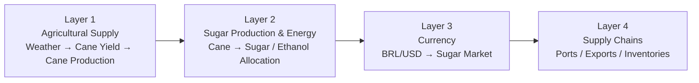
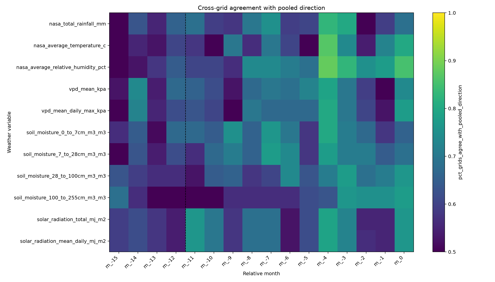

# Operation Sugar


**Independent quantitative research into Brazilian sugarcane and sugar markets, built on public data, explicit benchmarks, and reproducible experiments.**

Operation Sugar currently studies **annual agricultural sugarcane yield in São Paulo, Brazil**, measured in tonnes of cane per hectare. The active Layer-1 program combines municipality agricultural statistics, NASA POWER weather, Open-Meteo / ERA5 weather, and reproducible statistical experiments.

The project is deliberately benchmark-driven: new variables and model complexity are useful only when they add interpretable, reproducible information beyond simpler reference specifications.

## Research Snapshot

| Dimension | Current state |
|---|---|
| Primary target | Annual São Paulo sugarcane yield (t/ha) |
| Annual agricultural history | 1974–2025 |
| Municipality universe | 642 São Paulo municipalities |
| Detrending-eligible municipalities | 511 |
| Weather grid | ERA5 0.5° |
| Grid support | 78 grids; 76 qualify for current grid-specific correlation summaries |
| Complete all-variable yield years | 1982–2025 |
| Main late-weather window | Dec_(t-1) → Apr_t |
| Weather sources | NASA POWER + Open-Meteo / ERA5 |
| Agricultural source | IBGE municipal agricultural statistics |
| Completed experiments | EXP-01, EXP-02, EXP-03 |
| Immediate next experiment | **EXP-05 — conditional temperature–VPD yield response** |
| After EXP-05 | EXP-04 — focused continuous-outcome characterization |
| Validation checkpoint | **137 focused analysis / weather-ETL / soil-ETL tests passing** |
| Current release checkpoint | **v1.7.0 — adjusted-yield target + EXP-03 weather–yield discovery** |

## Four-Layer Research Framework



| Layer | Research focus | Status |
|---|---|---|
| **1. Agricultural supply** | Weather → annual cane yield → cane production | **Active** |
| **2. Sugar production and energy** | Cane → sugar output; recovery / ATR; ethanol–sugar allocation | Planned |
| **3. Currency** | BRL/USD and sugar prices | Planned |
| **4. Supply chains** | Ports, exports, transport, inventories, and physical availability | Planned |

The layers define a research sequence, not an established causal chain. Cane yield, cane production, sugar output, exports, and sugar prices are distinct targets.

---

## Current Layer-1 Pipeline

```text
IBGE annual municipality production + harvested area
                    │
                    ▼
         Municipality annual yield
                    │
                    ▼
     Municipality-first detrending
       P50=10 primary; P50=12 robustness
                    │
                    ▼
      Municipality yield residuals
                    │
                    ▼
ERA5-grid aggregation using annual harvested-area weights
                    │
                    ├──────────────┐
                    ▼              ▼
NASA POWER monthly weather   Open-Meteo / ERA5
                    │              │
                    └──────┬───────┘
                           ▼
                Aligned grid-year weather
                           │
                           ▼
                EXP-03 relationship discovery
                           │
                           ▼
          redundancy / conditional-information gates
                           │
                           ▼
            later continuous and predictive tests
```

Static SoilGrids properties are currently used only as **explanatory context** for spatial heterogeneity. They are not approved predictive inputs.

---

## Completed Research

### EXP-01 — Weather Feature Structure

EXP-01 characterized weather-to-weather overlap and temporal persistence before using yield.

Main conclusions:

- weather relationships are strongly calendar-month dependent;
- pooled all-month correlations can obscure or reverse month-specific structure;
- soil moisture is much more persistent than rainfall;
- temperature and VPD overlap substantially but correlation alone does not prove predictive redundancy;
- harvested-area weighting changes estimated weather relationships more than matched-support exclusion in the core comparisons.

Curated outputs: [`outputs/research/exp_01/`](outputs/research/exp_01/)

### EXP-02 — Yield Detrending and Spatial Composition

EXP-02 established the historical adjusted-yield target.

The approved primary representation is:

> **municipality yield → municipality-specific P50=10 detrending → residual → ERA5-grid aggregation with contemporaneous harvested-area weights**

Primary robustness checks:

- P50=12 detrending;
- common-support fixed composition;
- endpoint proximity;
- internal-gap proximity.

P50=10 and P50=12 residuals are highly similar. Changing within-grid production composition usually has a modest effect, but some grid-years show material differences.

Curated outputs: [`outputs/research/exp_02/`](outputs/research/exp_02/)

### EXP-03 — Yield-Stratified Weather Analysis

EXP-03 directly linked weather to the adjusted annual yield outcome.

Key findings:

1. **The clearest late-weather structure is Dec_(t-1) → Apr_t.**
2. **Dec–Jan is the strongest and most spatially coherent part of that window.**
3. **Feb–Mar is materially more heterogeneous across grids.**
4. **April partially reconverges spatially.**
5. Relative humidity and deeper soil moisture are among the most spatially stable late-window signals.
6. Rainfall, temperature, VPD, upper-soil moisture, and solar radiation remain informative but more heterogeneous.
7. March soil-moisture response changes materially with depth:
   - positive surface / positive deep: 42 grids;
   - negative surface / positive deep: 19 grids;
   - negative surface / negative deep: 13 grids;
   - positive surface / negative deep: 2 grids.
8. SoilGrids differences between March depth regimes are suggestive but strongly entangled with latitude and production-support structure; static soil remains explanatory-only.

Selected EXP-03 figure:



Curated outputs: [`outputs/research/exp_03/`](outputs/research/exp_03/)

---

## EXP-03 Redundancy Closure

Three representation duplicates were collapsed for downstream work:

| Concept | Canonical representation | Archived robustness representation |
|---|---|---|
| Solar | Mean-daily solar radiation | Monthly total solar |
| VPD | Mean VPD | Daily-max VPD |
| Upper soil moisture | 0–7 cm | 7–28 cm |

Only two multi-month summaries were promoted as candidate representations:

- **Dec–Jan relative humidity**
- **Dec–Jan 28–100 cm soil moisture**

No Jan–Feb, Feb–Mar, or Mar–Apr aggregate was promoted.

The resulting downstream universe contains **38 candidate representations**.

Important conditional-information questions remain protected:

- temperature ↔ VPD;
- rainfall ↔ upper-soil moisture;
- rainfall/history ↔ deep-soil moisture;
- upper ↔ deep-soil moisture.

See the reproducible Step-5 report:

[`outputs/research/exp_03/redundancy/EXP_03_redundancy_synthesis_report.md`](outputs/research/exp_03/redundancy/EXP_03_redundancy_synthesis_report.md)

---

## Current Research Sequence

The experiment IDs are historical identifiers; execution order may differ.

```text
EXP-01  Weather feature structure                     COMPLETE
EXP-02  Yield detrending / spatial composition        COMPLETE
EXP-03  Weather–yield discovery / heterogeneity       COMPLETE
EXP-05  Temperature–VPD conditional information      NEXT
EXP-04  Continuous adjusted-yield characterization    AFTER EXP-05
         Hydrological conditional follow-up            UNNUMBERED / LATER
EXP-06  Growth-stage aggregation                      PROPOSED
EXP-07  Incremental out-of-sample predictive value    PROPOSED
EXP-08  Spatial response heterogeneity                 LATER / CONDITIONAL
```

Dynamic Bayesian updating is intentionally deferred to a later **Weather 2.0** research phase rather than kept in the current v1.x experiment sequence.

See [`ROADMAP.md`](ROADMAP.md) for the current sequence and stop boundaries.

---

## Reproducibility

### Setup

```bash
git clone https://github.com/DuranWang/operation-sugar.git
cd operation-sugar
python -m pip install -r requirements.txt
```

The project targets Python 3.12. Large source archives and generated processed datasets are intentionally excluded from version control; curated research outputs are retained under `outputs/research/`.

### Current EXP-03 analysis modules

```text
src/analysis/exp03_yield_stratified_monthly_weather.py
src/analysis/exp03_checkpoint2_robustness.py
src/analysis/exp03_checkpoint2b_spatial_heterogeneity.py
src/analysis/exp03_harvest_profile_stability_audit.py
src/analysis/exp03_march_soil_moisture_depth.py
src/analysis/exp03_soil_regime_synthesis.py
src/analysis/exp03_redundancy_synthesis.py
```

### Focused test suite

```bash
python -m pytest src/tests/analysis src/tests/etl/weather src/tests/etl/soil -q
```

At the v1.7.0 checkpoint this suite passes **137 tests**.

---

## Prior Negative Benchmark

Before the annual-yield program, OS tested whether September–April rainfall and temperature improved **harvest-block crushing-volume** prediction beyond a historical harvest-profile benchmark.

They did not: the historical harvest-profile benchmark had the lowest held-out-season RMSE across the evaluated scales.

That negative result helped motivate the shift from operational crushing-volume prediction toward the cleaner agricultural-yield target.

See:

- [`month_level_model_findings.md`](month_level_model_findings.md)
- [`negative_results.md`](negative_results.md)

---

## Methodology Principles

- **Benchmark discipline:** compare new information against a relevant reference.
- **Matched samples:** separate support changes from modeling effects.
- **Temporal structure:** preserve month-specific relationships when pooling would be misleading.
- **Specification robustness:** retain reasonable alternative target definitions when conclusions depend on them.
- **Time-aware evaluation:** predictive claims require chronological validation and forecast-date information sets.
- **Training-only preprocessing:** estimated transformations and feature selection belong inside the training sample.
- **Negative results:** failed specifications remain part of the research record.
- **Interpretation discipline:** association, prediction, and causality are separate claims.

---

## Documentation

| Document | Purpose |
|---|---|
| [`ROADMAP.md`](ROADMAP.md) | Current experiment sequencing and research priorities |
| [`statistical_experiments.md`](statistical_experiments.md) | Experiment questions, methods, and findings |
| [`research_decisions.md`](research_decisions.md) | Major methodological choices and rationale |
| [`docs/architecture.md`](docs/architecture.md) | Current software and research-data architecture |
| [`docs/modeling_framework.md`](docs/modeling_framework.md) | Modeling and evaluation framework |
| [`docs/analytical_framework.md`](docs/analytical_framework.md) | Analytical-variable construction |
| [`docs/seasonal_framework.md`](docs/seasonal_framework.md) | Seasonal definitions and historical context |
| [`CHANGELOG.md`](CHANGELOG.md) | Release history |

## Contributing and Contact

Suggestions, bug reports, and research collaborations are welcome. Contributions should prioritize explicit assumptions, reproducibility, appropriate benchmarks, and demonstrable incremental value.

Contact: [Duran Wang on LinkedIn](https://www.linkedin.com/in/duranwang/)

Released under the [MIT License](LICENSE).
